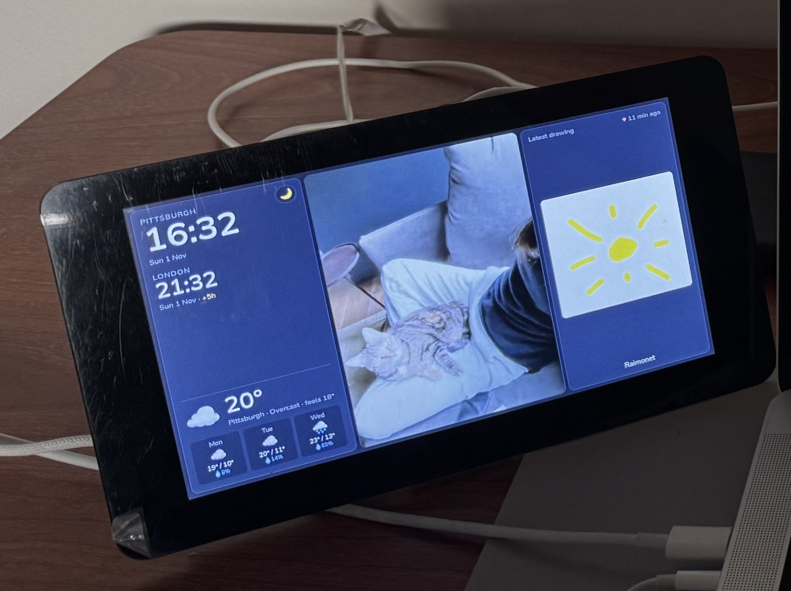
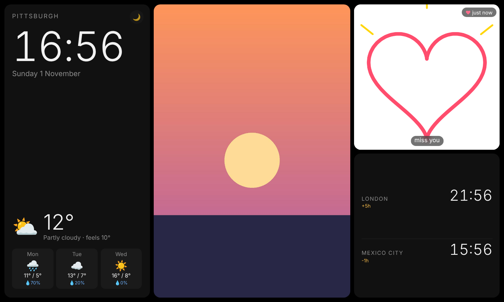
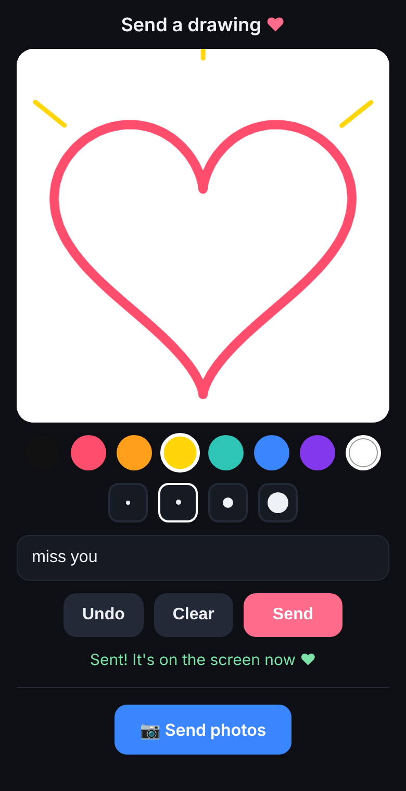
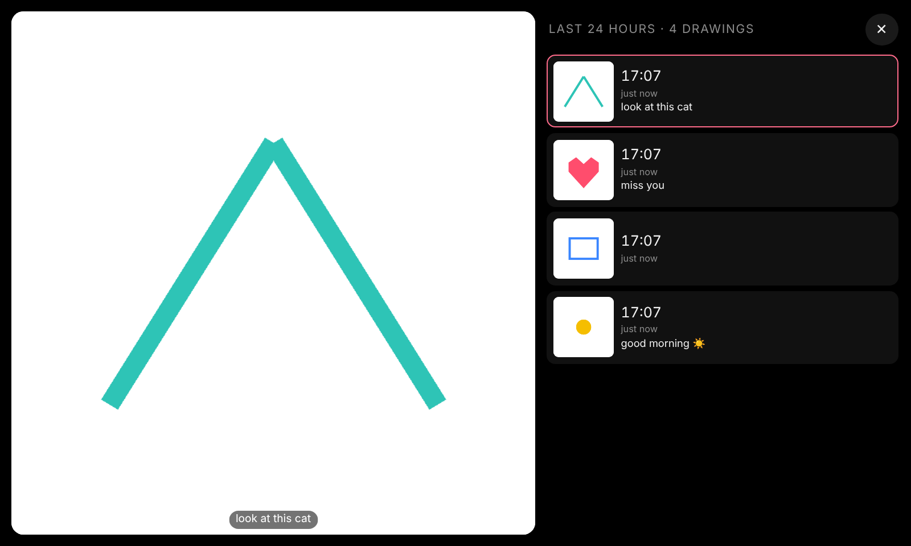

# LDD_raspi

**Long Distance Dashboard**: a Raspberry Pi touchscreen that keeps two people connected across time zones.

The screen at home always shows the time and weather, a slideshow of your photos, and the latest drawing from your partner. Your partner gets a private link on their phone. From it they can draw something or send photos straight from their camera, and it appears on the screen within seconds.



## Screenshots

**What's on the Pi screen:** main clock, weather, photo slideshow, the latest drawing, world clocks.



<table>
  <tr>
    <td width="32%" valign="top"><b>Partner's phone</b><br>Draw, add a message, send. Or send photos from the camera or gallery.<br><br></td>
    <td valign="top"><b>Tap the drawing</b>: timeline of the last 24 hours<br><br><br><b>Tap a photo</b>: full screen, uncropped<br></td>
  </tr>
</table>

## Features

| On the screen | From the phone link |
|---|---|
| Big main clock + date (Pittsburgh by default) | Draw with colors and brush sizes, undo, clear |
| World clocks with time difference (London, Mexico City) | Add a short message under the drawing |
| Current weather + 3-day forecast (no API key needed) | Send photos: take one with the camera or pick many from the gallery |
| Photo slideshow: tap = full screen, swipe = next/previous | Works on iPhone and Android, can be added to the home screen like an app |
| Latest drawing in a square, glows when new. Tap = timeline of every drawing from the last 24 h | |
| Sleeps at night (23:00 to 07:30), tap to wake, 🌙 button to sleep now | |

## How it works

```
 Partner's phone                         Raspberry Pi
 ───────────────                         ─────────────────────────────────────────
 Drawing page  ──HTTPS──▶ Tailscale ──▶  server.py :8081  (drawing page + uploads,
 (secret link)            Funnel                          needs the secret key)
                                              │ saves to photos/ and drawings/
                                              ▼
                                         server.py :8080  (dashboard, Pi only)
                                              │
                                         Chromium full screen (kiosk) on the touchscreen
```

- **`server.py`** is a small Python server with no extra packages needed. It runs two servers:
  - **Port 8080: the dashboard.** Only the Pi itself can open it, so your photos never leave the Pi.
  - **Port 8081: the drawing page and upload endpoint.** This is the only part exposed to the internet, through Tailscale Funnel. Every upload must include the secret key from `config.json`.
- **`web/dashboard.html`** is what the touchscreen shows. Weather comes from [Open-Meteo](https://open-meteo.com).
- **`web/draw.html`** is the page your partner opens on their phone.
- **`setup.sh`** installs everything: a service that starts the server on boot, full-screen browser at login, screen settings.
- Photos are saved in `photos/`. Drawings are saved in `drawings/` and each one is deleted 24 hours after it was sent (rolling, not at midnight). The newest drawing always stays in the square. Neither folder is uploaded to GitHub.

## What you need

- Raspberry Pi 4 or 5 (a 3B+ works too) with Raspberry Pi OS **with desktop** (64-bit recommended, not Lite)
- A touchscreen (the official 7" Pi display is ideal: the backlight fully turns off at night)
- Wi-Fi
- A free [Tailscale](https://tailscale.com) account (Google, GitHub or Microsoft login) so the phone link works from anywhere

## Install

### 1. Flash the SD card

On your computer, open [Raspberry Pi Imager](https://www.raspberrypi.com/software/):

1. **Device:** your Pi model. **OS:** Raspberry Pi OS (64-bit). **Storage:** your SD card.
2. In the settings/customisation step, fill in:
   - username and password (write them down)
   - your Wi-Fi name and password, country
   - time zone (for example `America/New_York`)
   - **turn on SSH** (password login)
3. Write the card, put it in the Pi and power it on. The first boot takes a few minutes.

### 2. Connect to the Pi

From a computer on the same Wi-Fi:

```bash
ssh YOUR_USER@raspberrypi.local
```

If `raspberrypi.local` doesn't work, use the Pi's IP address. You can find it in your router's app, or by running `hostname -I` on the Pi.

### 3. Download and install

On the Pi:

```bash
git clone https://github.com/RaiPujol/LDD_raspi.git
cd LDD_raspi
bash setup.sh
```

What `setup.sh` does:
1. Installs the emoji font used for the weather icons.
2. Creates `config.json` from `config.example.json` and generates a random **secret key**.
3. Installs the `pi-dashboard` service, so the server starts on every boot and restarts if it crashes.
4. Opens the dashboard full screen in Chromium every time the Pi starts.
5. Disables automatic screen blanking and lets the dashboard switch the backlight off at night.

At the end it prints a test link. Open it on your phone while connected to the same Wi-Fi, draw something and press **Send**.

Then restart:

```bash
sudo reboot
```

The Pi now boots straight into the dashboard.

### 4. Make the phone link work from anywhere (Tailscale Funnel)

On the Pi:

```bash
curl -fsSL https://tailscale.com/install.sh | sh
sudo tailscale up
```

`tailscale up` prints a login link. Open it on any device, log in, and **leave the terminal alone** until it prints `Success.` (pressing Ctrl+C cancels the login).

Then make **only the drawing page** public:

```bash
sudo tailscale funnel --bg 8081
```

The first time, it may print a link to enable Funnel (and HTTPS) on your account. Open it, approve, and run the command again. It then shows your public address, something like:

```
https://raspberrypi.tailXXXXX.ts.net
```

`--bg` keeps Funnel running after reboots, so you only do this once.

### 5. Send the link to your partner

Get your secret key:

```bash
grep key ~/LDD_raspi/config.json
```

The link is your Funnel address + `/#k=` + the key:

```
https://raspberrypi.tailXXXXX.ts.net/#k=YOUR_KEY
```

They only need to open it **once**: their phone remembers the key. The link never changes unless you rename the Pi, log it out of Tailscale, or change the key.

> Some messaging apps cut the part after `#` when making links clickable. If the page says *"This link is missing its secret key"*, copy the whole link and paste it into the browser's address bar.

## How your partner uses it

1. Open the link (tip: **Add to Home Screen** so it works like an app: iPhone: Share → Add to Home Screen; Android: ⋮ → Add to Home screen).
2. **To send a drawing:** draw in the white square, pick colors and brush sizes, optionally type a short message, press **Send**. It shows up on the screen within 5 seconds and the square glows until someone taps it.
3. **To send photos:** press **📷 Send photos**, then take a picture or pick several from the gallery. They're shrunk on the phone so they upload fast, and appear on the screen within about 20 seconds, shown first in the slideshow.

If it says *"Couldn't reach the screen"*, the Pi is off or offline. The link itself is still fine.

## Using the screen

| Action | What happens |
|---|---|
| Tap the photo | Full screen, tap again to close (closes by itself after 1 min) |
| Swipe the photo left / right | Next / previous photo |
| Tap the drawing | Timeline: every drawing from the last 24 h with time and message. Tap one to view it, ✕ to close |
| Tap 🌙 | Screen sleeps now, tap anywhere to wake |
| 23:00 to 07:30 | Screen off. A tap wakes it for 2 minutes |

## Adding your own photos from a computer

Easiest: use the same phone link and select many photos at once.

From a computer on the same Wi-Fi you can also copy a whole folder:

```bash
scp ~/Pictures/*.jpg YOUR_USER@raspberrypi.local:~/LDD_raspi/photos/
```

New photos appear within 20 seconds. To remove one, delete it from `~/LDD_raspi/photos/` on the Pi.

## Settings

Edit `~/LDD_raspi/config.json` on the Pi:

```bash
nano ~/LDD_raspi/config.json
sudo systemctl restart pi-dashboard
```

| Setting | Meaning |
|---|---|
| `photo_seconds` | Seconds each photo stays on screen (default 15) |
| `drawing_history_hours` | How long each drawing is kept in the timeline before it's deleted (default 24) |
| `sleep.off` / `sleep.on` | When the screen turns off / on, 24h format (default `23:00` / `07:30`) |
| `sleep.wake_minutes` | How long a tap at night keeps it awake (default 2) |
| `weather` | City name, latitude/longitude, time zone, `"celsius"` or `"fahrenheit"` |
| `clocks` | First entry = big main clock, the rest = world clocks. Time zone names: [list](https://en.wikipedia.org/wiki/List_of_tz_database_time_zones) (e.g. `Europe/Madrid`) |
| `key` | Secret for the phone link. To make a new one: set it to `"CHANGE-ME"`, run `bash setup.sh`, send the new link |

The sleep schedule follows the Pi's clock. If it's off by hours, set the time zone: `sudo raspi-config` → Localisation Options → Timezone.

## Updating

```bash
cd ~/LDD_raspi
git pull
bash setup.sh
sudo reboot
```

Your `config.json`, photos and drawings are kept: they're not part of the repo.

## Useful commands

| Command | What it does |
|---|---|
| `systemctl status pi-dashboard` | Is the server running? |
| `journalctl -u pi-dashboard -n 50` | Last 50 lines of server logs |
| `sudo systemctl restart pi-dashboard` | Restart the server (after changing settings) |
| `tailscale funnel status` | Shows the public address and whether Funnel is on |
| `hostname -I` | The Pi's local IP address |
| `ls ~/LDD_raspi/drawings` | Drawings from the last 24 h (one PNG + one JSON with the message each) |

## Troubleshooting

- **Screen shows the desktop instead of the dashboard:** run `bash setup.sh` again and reboot. Check that `~/.config/labwc/autostart` contains a `chromium ... localhost:8080` line.
- **"Weather unavailable":** the Pi has no internet. Check Wi-Fi.
- **Phone link doesn't load:** check `tailscale funnel status`. If empty, run `sudo tailscale funnel --bg 8081` again.
- **"Wrong key":** the key in the link doesn't match `config.json`. Send the link again with the current key.
- **Screen doesn't fully turn off at night:** your display has no controllable backlight, so it shows black instead. `setup.sh` tells you which one you have.

## Privacy

- The dashboard (port 8080) is only reachable from the Pi itself. Photos are never served to the internet.
- The only public part is the drawing page, and uploads are rejected without the secret key.
- `config.json` (with the key), `photos/` and `drawings/` are in `.gitignore`, so they're never pushed to GitHub.
